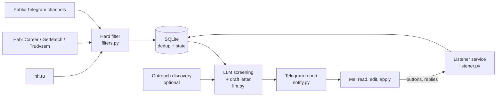

<div align="center">

# job-autofinder

**A personal job-search assistant: it watches several job sources, screens every vacancy with an LLM, drafts a short cover letter and reports to Telegram. I apply by hand.**


English | [Русский](README.ru.md)

</div>

> [!NOTE]
> The bot only prepares drafts. Sending an application is always a manual step; auto-apply is deliberately not built.

## Why

Reading a hundred postings to find the five that fit is slow, and generic cover letters do not work. The bot does the reading: it filters out what clearly does not fit, asks a model for a verdict with a reason, and writes a short letter built only from facts in my own profile. I read the card in Telegram, fix the text and send it myself.

A card looks like this (an invented example):

```
Backend developer (Python) · Acme Studio
Fit: maybe · Priority: normal · Grade: junior
Reason: Python and PostgreSQL match; two years of experience are asked for, the profile has less.
Attention: none

Здравствуйте!
Заинтересовала вакансия Python-разработчика. Работаю с Python и PostgreSQL, ...
[ ✕ Неинтересно ] [ Откликнулся ✅ ] [ Позже ⏳ ]
```

## At a glance

| | |
|---|---|
| Code | 30 Python files, about 4,000 lines |
| Sources | 5 (hh.ru, Habr Career, GetMatch, Trudvsem, public Telegram channels), each switchable in config or from the chat |
| State | one SQLite file: seen vacancies, LLM spend, button events, outreach targets |
| LLM cost | about $0.0005 per screened vacancy (`deepseek-flash`, see [docs/model-choice.md](docs/model-choice.md)); a hard daily budget stops calls and alerts |
| Runtime | cron every 15 minutes with random jitter and a lock file, a small `systemd` service for the Telegram buttons |
| History | 97 commits in Conventional Commits style, from 2026-10-08 |

## Features

**Search and filtering**
- Several title and full-text queries per source, remote-only by default; office and hybrid vacancies pass only for cities listed in the config.
- Hard filter before any model call: stop lists for roles and keywords, a seniority check, titles without a signal kept only when the description mentions the target stack.
- Salary never rejects a vacancy, it only changes the priority. One optional exception: a floor for full-time monthly rouble pay.
- Reposts of the same vacancy from another site are dropped before screening.

**LLM screening and drafts**
- A verdict (`fit`: yes / maybe / no), the main stack, the required grade and any permanent schedule or country restriction, as strict JSON.
- A letter of a few sentences built only from the candidate profile, with one honest sentence about a missing requirement instead of an invented skill.
- Prompts are plain YAML files chosen in the config, so the same code serves other professions.
- Vacancy text is treated as data: hidden characters are removed and phrases that address an AI are flagged.

**Telegram interface** (`jobbot/listener.py`)
- Buttons under every card: dismiss, mark as applied, snooze. Dismissed vacancies never come back.
- Reply to a card with an employer's questionnaire and the bot drafts answers in the same style. Phone and e-mail are placeholders for the model and are filled in by the program afterwards, so they never reach the LLM.
- Commands for statistics (month, year, all time), interviews and offers, rebuilding drafts, restoring dismissed cards, switching sources and channels. Applications older than 7 days without news count as rejected automatically.
- Alerts when a source is unreachable, a session expires, the model fails or the daily budget is reached; one heartbeat message a day.

**Direct outreach** (`jobbot/outreach/`, optional, off by default)
- Finds studios, outsourcing firms and agencies instead of vacancies, drafts a first message with the contact found on the company site and puts a card with buttons into the same chat. A reminder follows after a week.
- Fetching is polite: `robots.txt` is honoured, hosts are rate limited and private or cloud-metadata addresses are refused.

## Architecture



Key decisions:
- **Cheap steps first.** The filter and the dedup run before the model, so tokens are spent only on plausible vacancies. Screening uses the cheapest model setup: a test on 22 hand-labelled vacancies showed no quality gain from a bigger one.
- **Config, not code.** Queries, stop words, prompts, sources and limits live in `config.yaml`; the code has no search criteria in it.
- **One shared step for secondary sources** (`candidates.py`): Habr, GetMatch, Telegram and outreach all go through the same screening, draft and report.
- **Failure is visible.** Every external failure turns into an alert instead of a silent gap, and undelivered reports are resent on the next pass.
- **Secrets stay out.** The Telegram token is part of its URL, so exception text and URLs are never printed. gitleaks scans every push.

## A note on sources

Sources are plug-ins. hh.ru is read through the third-party [hh-applicant-tool](https://github.com/s3rgeym/hh-applicant-tool), because the official job-seeker API is closed; this is outside the service's rules, so use an account you can afford to lose. The bot only reads. Other sources use public pages and open APIs.

## Tech stack

| Area | Tools |
|---|---|
| Language | Python 3.11+ |
| Storage | SQLite |
| LLM | DeepSeek API (OpenAI-compatible); see [docs/model-choice.md](docs/model-choice.md) |
| Messaging | Telegram Bot API through a SOCKS5 proxy (`requests[socks]`) |
| Config | YAML (`pyyaml`), `.env` for secrets |
| Deploy | cron, `flock`, `systemd`; step-by-step in [docs/deployment.md](docs/deployment.md) |
| CI | GitHub Actions with gitleaks |

## Project structure

```
jobbot/
  run.py            pipeline for hh.ru
  candidates.py     shared step for Habr, GetMatch, Telegram
  filters.py        hard filter, priority, salary rules
  llm.py            screening, letters, answers, prompt loading
  store.py          SQLite schema and queries
  notify.py         Telegram messages, contact placeholders
  listener.py       buttons and commands (long polling)
  alerts.py         failure alerts and daily heartbeat
  hh.py habr.py getmatch.py trudvsem.py tgchannels.py   sources
  outreach/         discovery, search providers, polite fetching, targets
prompts/            prompt texts per candidate field
deploy/             cron wrappers, systemd unit
docs/               deployment guide, model choice, bot guide
tools/              one-off scripts: preview, model evaluation, draft rebuild
```

## Project history

All of it was built in one week.

| Date | What happened |
|---|---|
| 2026-10-08 | Repository, README, `.gitignore` |
| 2026-10-09 | Vacancy pipeline with LLM screening, cron wrapper, alerts and heartbeat, watchers for Habr, GetMatch and Telegram channels, the first buttons, personal-message drafts for channel posts |
| 2026-10-10 | Questionnaire warnings and answers, in-bot guide, gender-aware drafts, rebuild tool, outcome commands and monthly summary |
| 2026-10-11 | `/restore`, statistics for a period, channel commands, e-mail as a contact |
| 2026-10-12 | Direct-outreach subsystem, prompts and field words moved to config, source switches, defence against instructions hidden in vacancy text |
| 2026-10-13 | E-mail letters for outreach, optional salary floor |
| 2026-10-14 | Channel posts that link to an already seen vacancy are skipped, warnings only for permanent location and schedule limits, wording fixes in outreach pitches, LF line endings |

## What is not done

- No automated tests yet; checks are done with the preview scripts in `tools/` and by reading the output.
- Only DeepSeek is wired in; other OpenAI-compatible providers need small changes in `llm.py`.
- Prompts are in Russian, written for the Russian job market.
