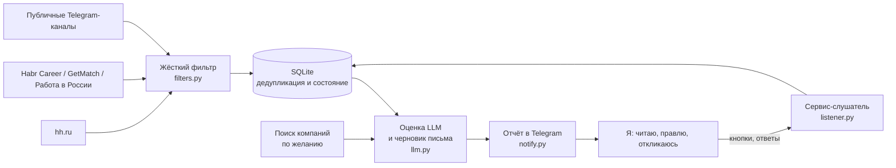

<div align="center">

# job-autofinder

**Личный помощник для поиска работы: следит за несколькими источниками вакансий, отбирает подходящие с помощью LLM, пишет короткий черновик отклика и присылает отчёт в Telegram. Откликаюсь я сам, вручную.**


[English](README.md) | Русский

</div>

> [!NOTE]
> Бот только готовит черновики. Отправка отклика всегда остаётся ручным шагом: автоотклик сознательно не сделан.

## Зачем

Перечитывать сотню вакансий ради пяти подходящих долго, а шаблонные письма не работают. Бот берёт чтение на себя: отсекает явно неподходящее, просит модель вынести вердикт с причиной и пишет короткое письмо только из фактов моего профиля. Я читаю карточку в Telegram, правлю текст и отправляю сам.

Так выглядит карточка (пример выдуман):

```
Backend developer (Python) · Acme Studio
Подходит: частично · Приоритет: обычный · Уровень: junior
Причина: Python и PostgreSQL совпадают; просят два года опыта, в профиле меньше.
Внимание: нет

Здравствуйте!
Заинтересовала вакансия Python-разработчика. Работаю с Python и PostgreSQL, ...
[ ✕ Неинтересно ] [ Откликнулся ✅ ] [ Позже ⏳ ]
```

## Коротко в цифрах

| | |
|---|---|
| Код | 30 файлов Python, около 4 000 строк |
| Источники | 5 (hh.ru, Habr Career, GetMatch, «Работа в России», публичные Telegram-каналы), каждый включается в конфиге или из чата |
| Состояние | один файл SQLite: просмотренные вакансии, расход на LLM, нажатия кнопок, цели для рассылки |
| Стоимость LLM | около $0,0005 за вакансию (`deepseek-flash`, см. [docs/model-choice.md](docs/model-choice.md)); жёсткий дневной бюджет останавливает вызовы и присылает предупреждение |
| Запуск | cron каждые 15 минут со случайной задержкой и lock-файлом, небольшой `systemd`-сервис для кнопок Telegram |
| История | 97 коммитов в стиле Conventional Commits, с 2026-10-08 |

## Возможности

**Поиск и фильтрация**
- Несколько запросов по названию и по полному тексту для каждого источника; по умолчанию только удалёнка, офис и гибрид проходят лишь для городов из конфига.
- Жёсткий фильтр до обращения к модели: стоп-листы ролей и слов, проверка уровня; названия без сигнала остаются, только если в описании есть нужный стек.
- Зарплата никогда не отсекает вакансию, а только меняет приоритет. Одно необязательное исключение: нижняя граница для полной занятости с месячной оплатой в рублях.
- Повторы одной вакансии с другого сайта отбрасываются до обращения к модели.

**LLM: оценка и черновики**
- Вердикт (`fit`: yes / maybe / no), основной стек, требуемый уровень и постоянные ограничения по графику или стране, строго в JSON.
- Письмо из нескольких предложений только по фактам профиля и одна честная фраза о недостающем требовании вместо выдуманного навыка.
- Промпты лежат в обычных YAML-файлах и выбираются в конфиге, так что тот же код подходит и для других профессий.
- Текст вакансии считается данными: скрытые символы удаляются, фразы, обращённые к ИИ, помечаются.

**Интерфейс в Telegram** (`jobbot/listener.py`)
- Кнопки под каждой карточкой: убрать, отметить отклик, отложить. Убранная вакансия больше не возвращается.
- Ответом на карточку можно прислать вопросы анкеты работодателя, и бот составит ответы в том же стиле. Телефон и почта для модели лишь метки, программа подставляет их позже, поэтому настоящие значения до LLM не доходят.
- Команды для статистики (месяц, год, всё время), собеседований и офферов, пересборки черновиков, возврата убранных карточек, переключения источников и каналов. Отклик старше 7 дней без новостей автоматически считается отказом.
- Уведомления, когда источник недоступен, сессия истекла, модель упала или достигнут дневной бюджет; раз в сутки приходит сообщение о том, что бот жив.

**Прямые обращения** (`jobbot/outreach/`, по желанию, по умолчанию выключено)
- Ищет студии, аутсорс-компании и агентства вместо вакансий, пишет первое сообщение с контактом, найденным на сайте компании, и присылает карточку с кнопками в тот же чат. Через неделю приходит напоминание.
- Страницы загружаются вежливо: учитывается `robots.txt`, на каждый хост действует ограничение частоты, частные адреса и адреса облачных метаданных отклоняются.

## Архитектура



Ключевые решения:
- **Сначала дешёвые шаги.** Фильтр и дедупликация идут до модели, поэтому токены тратятся только на правдоподобные вакансии. Для оценки взята самая дешёвая конфигурация: тест на 22 размеченных вручную вакансиях не показал выигрыша от более дорогой.
- **Конфиг, а не код.** Запросы, стоп-слова, промпты, источники и лимиты лежат в `config.yaml`, критериев поиска в коде нет.
- **Один общий шаг для вторичных источников** (`candidates.py`): Habr, GetMatch, Telegram и прямые обращения проходят одну и ту же оценку, черновик и отчёт.
- **Сбой виден.** Любая внешняя ошибка превращается в уведомление, а не в тихий пропуск, непришедшие отчёты повторяются на следующем проходе.
- **Секреты не попадают в код.** Токен Telegram входит в его URL, поэтому текст исключений и адреса никогда не выводятся. gitleaks проверяет каждый push.

## Об источниках

Источники подключаются как плагины. hh.ru читается через стороннюю утилиту [hh-applicant-tool](https://github.com/s3rgeym/hh-applicant-tool), потому что официальный API для соискателей закрыт; это выходит за рамки правил сервиса, поэтому используйте аккаунт, которым готовы рискнуть. Бот только читает. Остальные источники работают через публичные страницы и открытые API.

## Технологии

| Область | Инструменты |
|---|---|
| Язык | Python 3.11+ |
| Хранилище | SQLite |
| LLM | DeepSeek API (совместим с OpenAI); см. [docs/model-choice.md](docs/model-choice.md) |
| Сообщения | Telegram Bot API через SOCKS5-прокси (`requests[socks]`) |
| Конфигурация | YAML (`pyyaml`), секреты в `.env` |
| Развёртывание | cron, `flock`, `systemd`; пошагово в [docs/deployment.md](docs/deployment.md) |
| CI | GitHub Actions с gitleaks |

## Структура проекта

```
jobbot/
  run.py            конвейер для hh.ru
  candidates.py     общий шаг для Habr, GetMatch, Telegram
  filters.py        жёсткий фильтр, приоритет, правила по зарплате
  llm.py            оценка, письма, ответы, загрузка промптов
  store.py          схема SQLite и запросы
  notify.py         сообщения в Telegram, метки для контактов
  listener.py       кнопки и команды (long polling)
  alerts.py         уведомления о сбоях и ежедневный сигнал «жив»
  hh.py habr.py getmatch.py trudvsem.py tgchannels.py   источники
  outreach/         поиск компаний, поисковые провайдеры, вежливая загрузка, цели
prompts/            тексты промптов под сферу кандидата
deploy/             обёртки для cron, systemd-юнит
docs/               руководство по развёртыванию, выбор модели, справка бота
tools/              разовые скрипты: предпросмотр, оценка моделей, пересборка черновиков
```

## История проекта

Всё сделано за одну неделю.

| Дата | Что произошло |
|---|---|
| 2026-10-08 | Репозиторий, README, `.gitignore` |
| 2026-10-09 | Конвейер вакансий с оценкой LLM, обёртка для cron, уведомления и сигнал «жив», наблюдатели за Habr, GetMatch и Telegram-каналами, первые кнопки, черновики личных сообщений для постов в каналах |
| 2026-10-10 | Предупреждения об анкетах и ответы на них, справка в боте, формы рода в черновиках, инструмент пересборки, команды исходов и месячная сводка |
| 2026-10-11 | `/restore`, статистика за период, команды для каналов, почта как контакт |
| 2026-10-12 | Подсистема прямых обращений, промпты и слова сферы вынесены в конфиг, переключатели источников, защита от инструкций, спрятанных в тексте вакансии |
| 2026-10-13 | Письма по почте для прямых обращений, необязательная нижняя граница зарплаты |
| 2026-10-14 | Пропуск постов каналов, ссылающихся на уже виденную вакансию, предупреждения только о постоянных ограничениях по месту и графику, правки формулировок, переводы строк LF |

## Что не сделано

- Автоматических тестов пока нет; проверка идёт скриптами предпросмотра из `tools/` и чтением вывода.
- Подключён только DeepSeek; другим OpenAI-совместимым провайдерам нужны небольшие правки в `llm.py`.
- Промпты на русском языке и рассчитаны на российский рынок вакансий.
